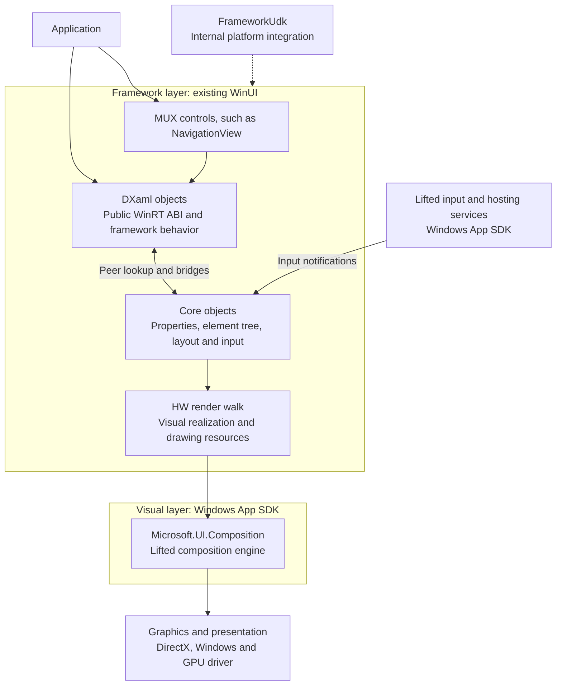
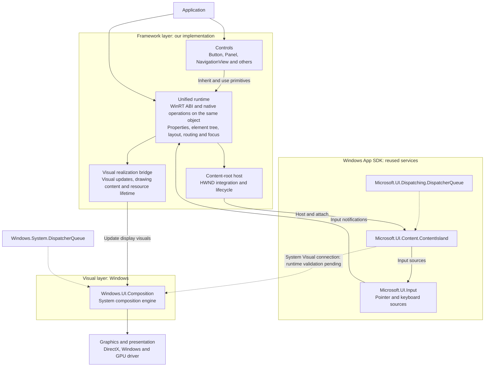

# Existing and proposed layers

The proposed architecture follows [Project goals](../project-goals.md): one runtime object model, WUC composition, and lifted input. These diagrams show responsibilities and platform dependencies, not DLLs, source directories, inheritance trees, or complete call graphs.

Solid arrows show use or data flow. Dotted arrows show supporting dependencies or a connection still to establish. The existing diagram describes the lifted-compositor path; it does not claim that every WinUI configuration uses that engine.

## Existing WinUI: Core/DXaml and lifted composition

The Core/DXaml split is inside the framework layer. For example, the public-facing `UIElement` and internal `CUIElement` are peers; this is distinct from the Composition Visual used to display the element. Controls such as Button have implementation responsibilities spread across both sides. Newer MUX controls also use the underlying framework; they do not bypass it.

## Proposed WinUI: unified runtime, WUC and lifted input

The WUC/lifted-Content connection is implemented through `ContentIsland.CreateForSystemVisual` in the native backend. Runtime availability, feature gates, HWND hosting, coordinate mapping, and lifecycle still need execution evidence. See [Framework foundations](framework-foundations.md); successful compilation alone does not validate this connection.

The runtime's custom scheduler owns framework work ordering and invalidation coalescing. It does not automatically replace the platform queues shown above. IME, text editing, accessibility, and optional Windows App SDK features need their own integration contracts and are omitted from these overview diagrams.

## What changes

| Concern | Existing lifted-compositor path | Proposed architecture |
| --- | --- | --- |
| Framework objects | Core and DXaml peer objects, with state and lifetime responsibilities crossing the boundary. | One authoritative runtime implementation per framework object, including its WinRT interfaces. |
| Concrete controls | Older control responsibilities cross Core/DXaml; MUX controls build on the framework. | Concrete controls belong under `src/controls`; runtime primitives remain shared foundations. |
| Display realization | HW render walk and Composition realization infrastructure. | A focused bridge from settled runtime state to WUC visuals and drawing resources. |
| Composition | Lifted MUC engine in the path shown here. | Windows-provided WUC engine. |
| Input | Lifted platform input feeds existing framework input processing. | Lifted platform input feeds the unified runtime's element routing and focus policy. |
| Platform integration | Includes existing FrameworkUdk-dependent features. | Retain only required dependencies; decide FrameworkUdk use per feature. |

## Two trees still have different jobs

- The **element tree** owns framework semantics: parentage, properties, layout, event routes, and logical focus.
- The **Composition Visual tree** owns display state: transforms, clips, opacity, drawing content, and composition animations.

Removing Core/DXaml peers does not remove the Visual tree. A visual realization is a display resource, not another framework object with duplicated dependency-property storage or lifetime semantics. Do not require one Visual per UIElement; choose realization granularity according to rendering needs.

Input, ContentIsland, queues, and the HWND host support the layers from the side. They are not additional layers between Framework, Visual, and Graphics. Direct2D and DirectWrite may also be called by our drawing-content code; the graphics box does not imply that all graphics work passes only through the compositor.

## References

- [Core/DXaml and peer objects in the upstream design notes](/D:/source/mux-main/docs/design-notes/dxamlvscore.md)
- [WUC hosting in a Win32 application](https://learn.microsoft.com/en-us/windows/uwp/composition/using-the-visual-layer-with-win32)
- [ContentIsland.CreateForSystemVisual](https://learn.microsoft.com/en-us/windows/windows-app-sdk/api/winrt/microsoft.ui.content.contentisland.createforsystemvisual?view=windows-app-sdk-2.0)
