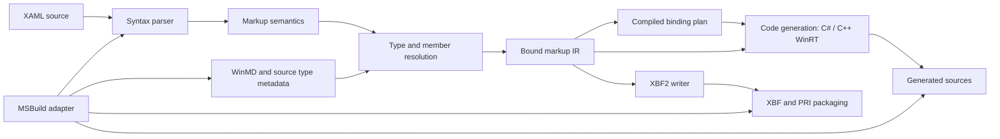

# XAML compiler rearchitecture

Status: staged design with an implemented XML syntax reader. The new compiler cannot yet generate code or XBF.

## Existing implementation

The upstream reference is `D:/source/mux-main/src/XamlCompiler` (reviewed 2026-10-24):

- `BuildTasks/CompileXamlInternal.cs` combines incremental state, schema loading, validation, page/type-info code generation, binding generation, and XBF orchestration. It carries pass-one/pass-two state and loads referenced assemblies.
- `BuildTasks/Microsoft/Xaml/XamlCompiler/XamlCodeGenerator.cs` selects language-specific T4-based emitters; C# and C++/WinRT have distinct generated-code conventions.
- `BuildTasks/Microsoft/Xaml/XBF/XbfGenerator.cs` loads the architecture-specific native `GenXbf.dll` and invokes its XBF generation entry points. XBF generation is therefore a separate binary/tooling contract.
- `Targets/Microsoft.UI.Xaml.Markup.Compiler.interop.targets` supplies design-time and real-build targets for markup passes 1 and 2 and marshals compiler inputs/outputs through MSBuild.
- `Microsoft.UI.Xaml.Markup.Compiler.csproj` targets `net472;net8.0` and includes legacy `System.Xaml`, reflection/metadata infrastructure, generated ANTLR sources, and T4 output.

Porting the task class directly would preserve coupling between project evaluation, type discovery, code generation, XBF emission, and mutable incremental caches.

## Compiler boundaries

1. **Syntax** reads XML without executing markup or loading an application. Preserve namespace declarations, ordered attributes/children, text, and source locations. Unknown XAML constructs remain representable.
2. **Markup semantics** interprets property elements, attached members, markup extensions, namescopes, `x:Class`, `x:Name`, `x:Key`, conditional namespaces, and deferred resources. It preserves declaration order and identifies scopes before resolving types.
3. **Type resolution** uses the public WinMD contract plus project metadata, not runtime implementation classes. Model activatability, assignability, content properties, collections, dependency properties, events, and attached members. Resolve application-defined managed types through compiler metadata without executing the application assembly.
4. **Bound markup IR** records the selected type/member identities, values, resources, bindings, diagnostic locations, and deferred scopes. Keep the IR private and versioned internally; it is not a public WinRT ABI or the serialized XBF format.
5. **Backends** consume the same bound IR. C++/WinRT and C# source generation follow their respective code-behind and activation contracts. The XBF2 writer emits exactly the format the new runtime loader accepts. `x:Bind` has its own typed binding plan and language-specific lowering; it must honor data-template types, update modes, notifications, and object lifetime.
6. **Build adapter** consumes MSBuild items/references and returns generated items/diagnostics. It owns intermediate paths, dependency tracking, PRI integration, and deployment inputs. The compiler engine stays usable without MSBuild or Visual Studio.

The runtime owns type activation, markup loading, resources, event hookups, and binding execution. Compiler and runtime agree on explicit WinRT identities, XBF versions, resource URI conventions, and namescope/deferred-load semantics. Neither side creates a second framework object model.

## Compatibility and incremental builds

- Preserve existing XBF2 serialization/index rules for any binary compatibility claimed. Lock the target runtime version and stable type/property index mapping against a chosen SDK baseline; never derive persisted indexes from internal native class IDs.
- Initially compare output against the upstream compiler and `GenXbf.dll` on a pinned XAML fixture corpus. Evaluate a managed XBF writer, including the existing XbfKit work, only after reader compatibility and licensing/dependency terms are verified. A clean writer must reproduce loader-visible semantics, not necessarily byte-identical files.
- Treat C# pass 1 (generated source stubs) and pass 2 (resolution after compilation) as an explicit dependency cycle; model generated declarations and resolved symbols separately. Keep C++/WinRT output compatible with its include/module and build ordering requirements.
- Use per-file source hashes, referenced symbol signatures, compiler/options versions, and target XBF/runtime versions as cache inputs. Cache only immutable syntax/bound artifacts, and invalidate dependent pages when contracts or resource names change. Do not keep static loaded-assembly or native-DLL caches across MSBuild invocations.
- Emit deterministic artifacts under `artifacts/obj`, with stable diagnostics (code, path, line, column). Design-time compilation should recover and report partial results without writing deployable XBF on erroneous input.
- Keep the compiler opt-in while the native runtime and public WinRT surface are being established. Merely adding a project to the solution must not make markup compilation a prerequisite of the minimal native-host milestone.

## Delivery sequence

| Stage | Runnable proof | Gate |
| --- | --- | --- |
| 0: syntax | `src/compiler` reads XAML into namespace-aware syntax with precise XML errors | Source fidelity, entity safety, deterministic parse results |
| 1: semantic model | Resolve one external WinMD-backed type, a DP, an attached property, and a named element | Diagnostics and type identities match the chosen reference baseline |
| 2: native XAML | Emit/load a minimal XBF2 file or equivalent explicitly versioned compiled markup via the unified runtime | XAML-created and code-created element trees behave identically |
| 3: C++/WinRT | Compile an external app's code-behind with generated declarations, event hookup, and resources | Normal MSBuild build, run, and clean rebuild |
| 4: C# and bindings | Compile `x:Class`, `x:Bind`, and templates for an external C# app | Pass 1/2, CLR ownership, change propagation, and AOT requirements validated |
| 5: packaging and migration | Ship compiler targets, XBF/PRI, WinMD and runtime in the NuGet integration | Pinned reference application builds, runs, and deploys independently |

## Implemented slice

`src/compiler/Syntax/XamlSyntaxParser.cs` provides a self-contained .NET 10 syntax front end. It resolves XML namespace URIs, records namespace declarations separately from property attributes, retains element/attribute order and text/CDATA, reports XML locations, and rejects DTDs/external entities. `tests/compiler` exercises these guarantees without requiring native XAML components.

This slice does not yet interpret XAML names or markup extensions, validate against WinMD, produce bound IR, generate C++/C# code, or emit XBF. Its scope is deliberately independent of the current native runtime's unfinished public API and hosting work.
